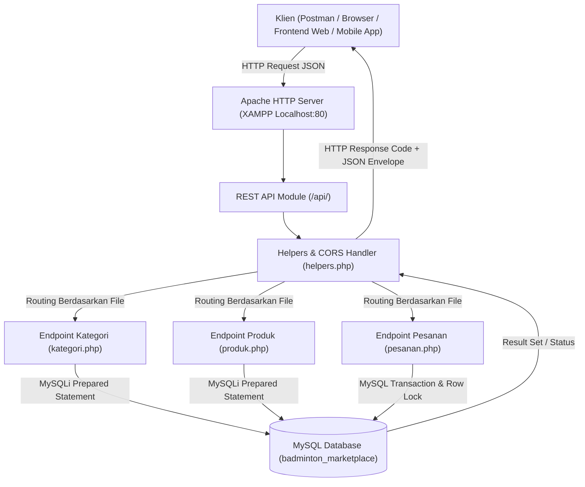
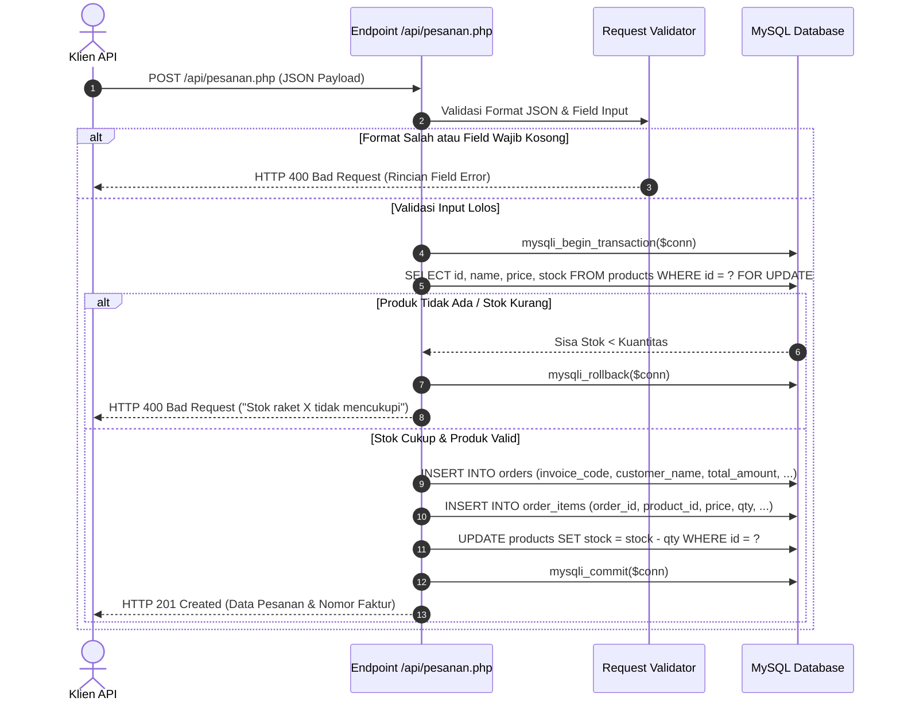

# DOKUMEN RANCANGAN ENDPOINT REST API
## Aplikasi Marketplace SmashZone (Tugas Soal 12)
**Spesifikasi Teknis & Desain Web Service / REST API Marketplace Raket Badminton**

---

### Informasi Dokumen
- **Nama Dokumen**: Dokumen Rancangan Endpoint REST API Marketplace
- **Aplikasi**: SmashZone Badminton Marketplace
- **Tugas**: Soal 12 – Pengembangan Web Service / REST API Marketplace
- **Teknologi**: PHP Native, MySQLi, MySQL, Apache (XAMPP)
- **Format Pertukaran Data**: JSON (`application/json; charset=UTF-8`)
- **Base URL API**: `http://localhost/web_marketpls/api`
- **Versi API**: 1.0.0
- **Penyusun**: Web Developer

---

## 1. PENDAHULUAN & TUJUAN ARSITEKTUR

Dokumen ini mendefinisikan spesifikasi perancangan, kontrak antarmuka (*interface contract*), skema data, validasi, dan penanganan kesalahan untuk modul **RESTful API** pada aplikasi **SmashZone**.

Modul REST API ini dikembangkan secara murni menggunakan **PHP Native** dan **MySQLi** tanpa ketergantungan pada framework eksternal, berjalan di atas web server lokal **XAMPP**, serta terintegrasi langsung dengan database relasional `badminton_marketplace` yang sudah ada tanpa mengubah fitur lama antarmuka website.

### Standar Arsitektur REST yang Diterapkan:
1. **Stateless Communication**: Setiap request membawa seluruh informasi yang diperlukan tanpa bergantung pada session server.
2. **Representasi Format Murni JSON**: Header `Content-Type: application/json; charset=UTF-8` digunakan secara konsisten pada setiap respon.
3. **Standar Kode Status HTTP**: Menggunakan status code semantik (`200 OK`, `201 Created`, `400 Bad Request`, `404 Not Found`, `405 Method Not Allowed`, dan `500 Internal Server Error`).
4. **Keamanan Prepared Statements**: Seluruh parameter dan masukan pengguna diikat (*parameter binding*) untuk mencegah celah SQL Injection.
5. **Database Transaction Atomik**: Pada operasi penulisan pesanan (`POST /api/pesanan.php`), diterapkan `mysqli_begin_transaction` dengan penguncian baris (`FOR UPDATE`) untuk menjamin konsistensi stok dan mencegah *race condition*.

---

## 2. FORMAT STANDAR RESPON API (RESPONSE ENVELOPE)

Seluruh respon endpoint API dibungkus ke dalam format terstruktur yang konsisten (*Envelope Format*):

### 2.1 Format Respon Sukses (HTTP 200 / 201)
```json
{
  "status": "success",
  "code": 200,
  "message": "Pesan deskripsi keberhasilan operasi.",
  "data": { ... }
}
```

### 2.2 Format Respon Error (HTTP 400 / 404 / 405 / 500)
```json
{
  "status": "error",
  "code": 400,
  "message": "Pesan deskripsi kesalahan.",
  "errors": {
    "field_name": "Rincian pesan validasi field terkait."
  }
}
```

---

## 3. DIAGRAM ALUR & ARSITEKTUR SISTEM

### 3.1 Diagram Arsitektur Interaksi REST API



### 3.2 Diagram Sequence Transaksi Pemesanan (`POST /api/pesanan.php`)



---

## 4. SPESIFIKASI RINCI ENDPOINT REST API

---

### ENDPOINT 1: Dokumentasi & Katalog Indeks API
- **Endpoint**: `/api/index.php` atau `/api/`
- **Metode HTTP**: `GET`
- **Fungsi**: Menampilkan spesifikasi ringkas seluruh endpoint yang tersedia pada REST API SmashZone.
- **Header Request**:
  - `Accept: application/json`

#### Query Parameters:
*Tidak ada.*

#### Contoh Permintaan (cURL):
```bash
curl -X GET "http://localhost/web_marketpls/api/index.php" \
  -H "Accept: application/json"
```

#### Respon Sukses (`HTTP 200 OK`):
```json
{
  "status": "success",
  "code": 200,
  "message": "Dokumentasi REST API SmashZone Marketplace",
  "data": {
    "name": "SmashZone Badminton Marketplace REST API",
    "version": "1.0.0",
    "environment": "PHP Native, MySQLi, MySQL, XAMPP",
    "base_url": "http://localhost/web_marketpls/api",
    "endpoints": [
      {
        "endpoint": "/api/kategori.php",
        "method": "GET",
        "description": "Menampilkan daftar seluruh kategori produk raket badminton."
      },
      {
        "endpoint": "/api/produk.php",
        "method": "GET",
        "description": "Menampilkan daftar seluruh produk raket (filter & search)."
      },
      {
        "endpoint": "/api/produk.php?id={id}",
        "method": "GET",
        "description": "Menampilkan detail lengkap satu produk raket badminton."
      },
      {
        "endpoint": "/api/pesanan.php",
        "method": "POST",
        "description": "Menyimpan transaksi pesanan baru & potong stok otomatis."
      }
    ]
  }
}
```

---

### ENDPOINT 2: Daftar Seluruh Kategori Produk
- **Endpoint**: `/api/kategori.php`
- **Metode HTTP**: `GET`
- **Fungsi**: Mengambil daftar seluruh kategori raket beserta agregasi jumlah produk di tiap kategori.
- **Header Request**:
  - `Accept: application/json`

#### Query Parameters:
*Tidak ada (menampilkan seluruh kategori).*

#### Contoh Permintaan (cURL):
```bash
curl -X GET "http://localhost/web_marketpls/api/kategori.php" \
  -H "Accept: application/json"
```

#### Respon Sukses (`HTTP 200 OK`):
```json
{
  "status": "success",
  "code": 200,
  "message": "Daftar kategori berhasil diambil.",
  "data": {
    "total": 4,
    "categories": [
      {
        "id": 1,
        "name": "Power & Smash (Head Heavy)",
        "slug": "power-smash",
        "description": "Raket dengan bobot condong ke kepala untuk menghasilkan smash keras dan bertenaga.",
        "total_products": 4
      },
      {
        "id": 2,
        "name": "Speed & Drive (Head Light)",
        "slug": "speed-drive",
        "description": "Raket lincah dengan frame aerodinamis untuk rally cepat dan permainan ganda lincah.",
        "total_products": 2
      },
      {
        "id": 3,
        "name": "All-Around & Control (Even Balance)",
        "slug": "all-around",
        "description": "Keseimbangan sempurna antara daya serang dan pertahanan dengan akurasi kontrol tinggi.",
        "total_products": 3
      },
      {
        "id": 4,
        "name": "Beginner & All Level",
        "slug": "beginner-friendly",
        "description": "Raket fleksibel yang ramah untuk pemula dan pemain rekreasional dengan sweet spot luas.",
        "total_products": 1
      }
    ]
  }
}
```

---

### ENDPOINT 3: Detail Kategori Berdasarkan ID
- **Endpoint**: `/api/kategori.php?id={id}`
- **Metode HTTP**: `GET`
- **Fungsi**: Mengambil informasi rinci satu kategori beserta daftar produk di bawah kategori tersebut.
- **Header Request**:
  - `Accept: application/json`

#### Query Parameters:
| Parameter | Tipe | Wajib | Keterangan |
|---|:---:|:---:|---|
| `id` | Integer | Ya | ID unik kategori (bilangan bulat positif >= 1). |

#### Contoh Permintaan:
```bash
curl -X GET "http://localhost/web_marketpls/api/kategori.php?id=1" \
  -H "Accept: application/json"
```

#### Respon Sukses (`HTTP 200 OK`):
```json
{
  "status": "success",
  "code": 200,
  "message": "Berhasil mengambil data kategori ID 1.",
  "data": {
    "id": 1,
    "name": "Power & Smash (Head Heavy)",
    "slug": "power-smash",
    "description": "Raket dengan bobot condong ke kepala untuk menghasilkan smash keras dan bertenaga.",
    "total_products": 4,
    "products": [
      {
        "id": 1,
        "name": "Yonex Astrox 88D Pro (3rd Gen)",
        "brand": "Yonex",
        "price": 2850000,
        "stock": 13,
        "image": "racket_astrox_88d.svg",
        "is_featured": 1,
        "image_url": "http://localhost/web_marketpls/assets/images/racket_astrox_88d.svg"
      }
    ]
  }
}
```

#### Respon Error Kategori Tidak Ditemukan (`HTTP 404 Not Found`):
```json
{
  "status": "error",
  "code": 404,
  "message": "Kategori dengan ID 9999 tidak ditemukan."
}
```

#### Respon Error Parameter Invalid (`HTTP 400 Bad Request`):
```json
{
  "status": "error",
  "code": 400,
  "message": "Parameter 'id' tidak valid. ID kategori harus berupa bilangan bulat positif."
}
```

---

### ENDPOINT 4: Katalog Seluruh Produk Raket (Dengan Filter & Search)
- **Endpoint**: `/api/produk.php`
- **Metode HTTP**: `GET`
- **Fungsi**: Mengambil seluruh daftar produk raket dengan dukungan filter multi-parameter.
- **Header Request**:
  - `Accept: application/json`

#### Query Parameters (Opsional):
| Parameter | Tipe | Contoh Nilai | Keterangan |
|---|:---:|---|---|
| `category_id` | Integer | `1` | Memfilter produk berdasarkan ID kategori raket. |
| `brand` | String | `Yonex` | Memfilter produk berdasarkan nama brand (Yonex, Victor, Li-Ning, dll). |
| `search` / `q` | String | `Ryuga` | Mencari kata kunci pada nama, brand, atau deskripsi raket. |
| `featured` | Integer | `1` | Filter produk unggulan (`1` untuk produk pilihan toko). |
| `sort` | String | `price_asc` | Pengurutan (`price_asc`, `price_desc`, `latest`, `name_asc`, `stock_desc`). |

#### Contoh Permintaan (cURL):
```bash
curl -X GET "http://localhost/web_marketpls/api/produk.php?brand=Yonex&sort=price_desc" \
  -H "Accept: application/json"
```

#### Respon Sukses (`HTTP 200 OK`):
```json
{
  "status": "success",
  "code": 200,
  "message": "Daftar produk berhasil diambil.",
  "data": {
    "total": 4,
    "filters": {
      "category_id": null,
      "brand": "Yonex",
      "search": null,
      "sort": "price_desc"
    },
    "products": [
      {
        "id": 2,
        "seller_id": 1,
        "seller_name": "Official SmashZone Store",
        "category_id": 2,
        "category_name": "Speed & Drive (Head Light)",
        "category_slug": "speed-drive",
        "name": "Yonex Nanoflare 1000Z",
        "brand": "Yonex",
        "price": 2950000,
        "stock": 12,
        "weight_grip": "4U/G5",
        "tension_lbs": "20 - 28 LBS",
        "balance_point": "Head Light (290mm)",
        "flexibility": "Extra Stiff",
        "image": "racket_nanoflare_1000z.svg",
        "is_featured": 1,
        "created_at": "2026-11-06 22:58:00",
        "image_url": "http://localhost/web_marketpls/assets/images/racket_nanoflare_1000z.svg"
      }
    ]
  }
}
```

---

### ENDPOINT 5: Detail Satu Produk Raket Berdasarkan ID
- **Endpoint**: `/api/produk.php?id={id}`
- **Metode HTTP**: `GET`
- **Fungsi**: Menampilkan detail lengkap satu raket badminton beserta spesifikasi teknis dan testimoni ulasan pembeli.
- **Header Request**:
  - `Accept: application/json`

#### Query Parameters:
| Parameter | Tipe | Wajib | Keterangan |
|---|:---:|:---:|---|
| `id` | Integer | Ya | ID unik produk raket (bilangan bulat positif >= 1). |

#### Contoh Permintaan (cURL):
```bash
curl -X GET "http://localhost/web_marketpls/api/produk.php?id=1" \
  -H "Accept: application/json"
```

#### Respon Sukses (`HTTP 200 OK`):
```json
{
  "status": "success",
  "code": 200,
  "message": "Berhasil mendapatkan detail produk ID 1.",
  "data": {
    "id": 1,
    "seller_id": 1,
    "seller_name": "Official SmashZone Store",
    "category_id": 1,
    "category_name": "Power & Smash (Head Heavy)",
    "category_slug": "power-smash",
    "name": "Yonex Astrox 88D Pro (3rd Gen)",
    "brand": "Yonex",
    "price": 2850000,
    "stock": 13,
    "weight_grip": "4U/G5",
    "tension_lbs": "20 - 28 LBS",
    "balance_point": "Head Heavy (305mm)",
    "flexibility": "Stiff",
    "description": "Raket andalan pemain ganda belakang level dunia. Memberikan daya hancur smash maksimal dengan teknologi Rotational Generator System Plus.",
    "image": "racket_astrox_88d.svg",
    "is_featured": 1,
    "created_at": "2026-11-06 22:58:00",
    "image_url": "http://localhost/web_marketpls/assets/images/racket_astrox_88d.svg",
    "rating": {
      "average": 5,
      "count": 1,
      "reviews": [
        {
          "id": 1,
          "user_name": "Taufik H.",
          "rating": 5,
          "comment": "Smash terasa sangat padat dan bertenaga! Raket 100% original, pengemasan dengan pipa PVC sangat aman.",
          "created_at": "2026-11-06 22:58:00"
        }
      ]
    }
  }
}
```

#### Respon Error Produk Tidak Ditemukan (`HTTP 404 Not Found`):
```json
{
  "status": "error",
  "code": 404,
  "message": "Produk dengan ID 99999 tidak ditemukan."
}
```

#### Respon Error Parameter Invalid (`HTTP 400 Bad Request`):
```json
{
  "status": "error",
  "code": 400,
  "message": "Parameter 'id' tidak valid. ID produk harus berupa bilangan bulat positif."
}
```

---

### ENDPOINT 6: Pembuatan Transaksi Pesanan Baru (Orders)
- **Endpoint**: `/api/pesanan.php`
- **Metode HTTP**: `POST`
- **Fungsi**: Memvalidasi data pemesan, memverifikasi ketersediaan stok, mengunci baris produk (`FOR UPDATE`), membuat invoice unik, mencatat ke tabel `orders` dan `order_items`, serta memotong kuantitas stok di tabel `products` secara atomik melalui transaksi MySQL.
- **Header Request**:
  - `Content-Type: application/json`
  - `Accept: application/json`

#### Struktur Payload Body (JSON):
| Atribut | Tipe Data | Wajib | Aturan Validasi |
|---|:---:|:---:|---|
| `customer_name` | String | Ya | Minimal 3 karakter, nama lengkap pemesan. |
| `customer_email` | String | Ya | Format email valid (`FILTER_VALIDATE_EMAIL`). |
| `customer_phone` | String | Ya | Format nomor telepon/WhatsApp 8-20 digit (`^[0-9+\-\s]{8,20}$`). |
| `shipping_address` | String | Ya | Alamat lengkap tujuan pengiriman (minimal 8 karakter). |
| `courier` | String | Tidak | Pilihan jasa pengiriman (default: `JNE Regular`). |
| `payment_method` | String | Tidak | Pilihan metode bayar (default: `Transfer Bank BCA`). |
| `notes` | String | Tidak | Catatan tambahan pesanan. |
| `items` | Array | Ya | Array daftar barang belanjaan, tidak boleh kosong. |
| `items[].product_id` | Integer | Ya | ID produk raket yang valid (integer positif >= 1). |
| `items[].quantity` | Integer | Ya | Jumlah yang dibeli (integer minimal 1). |

> [!IMPORTANT]
> **Anti-Tampering Price Protection**: Klien sengaja tidak diizinkan mengirimkan harga satuan (`price`). Harga produk diambil langsung dari database saat transaksi berlangsung untuk mencegah manipulasi harga dari sisi pengguna.

#### Contoh Permintaan (cURL):
```bash
curl -X POST "http://localhost/web_marketpls/api/pesanan.php" \
  -H "Content-Type: application/json" \
  -H "Accept: application/json" \
  -d '{
    "customer_name": "Muhammad Rizky Pratama",
    "customer_email": "rizky.pratama@gmail.com",
    "customer_phone": "081298765432",
    "shipping_address": "Jl. Gatot Subroto Kav. 52, Tebet, Jakarta Selatan 12870",
    "courier": "JNE Regular",
    "payment_method": "Transfer Bank BCA",
    "notes": "Mohon sertakan pelindung pipa PVC untuk raket.",
    "items": [
      {
        "product_id": 1,
        "quantity": 1
      }
    ]
  }'
```

#### Respon Sukses (`HTTP 201 Created`):
```json
{
  "status": "success",
  "code": 201,
  "message": "Pesanan berhasil dibuat dengan nomor invoice INV-20261118-8A8A8.",
  "data": {
    "order_id": 8,
    "invoice_code": "INV-20261118-8A8A8",
    "status": "pending",
    "customer": {
      "name": "Muhammad Rizky Pratama",
      "email": "rizky.pratama@gmail.com",
      "phone": "081298765432",
      "shipping_address": "Jl. Gatot Subroto Kav. 52, Tebet, Jakarta Selatan 12870"
    },
    "shipping": {
      "courier": "JNE Regular",
      "payment_method": "Transfer Bank BCA",
      "notes": "Mohon sertakan pelindung pipa PVC untuk raket."
    },
    "summary": {
      "total_items": 1,
      "total_amount": 2850000,
      "total_amount_formatted": "Rp 2.850.000"
    },
    "items": [
      {
        "product_id": 1,
        "product_name": "Yonex Astrox 88D Pro (3rd Gen)",
        "price": 2850000,
        "quantity": 1,
        "subtotal": 2850000,
        "id": 9
      }
    ],
    "created_at": "2026-11-18 23:36:11"
  }
}
```

#### Respon Error Validasi Input Gagal (`HTTP 400 Bad Request`):
```json
{
  "status": "error",
  "code": 400,
  "message": "Validasi request pesanan gagal. Mohon periksa kembali input Anda.",
  "errors": {
    "customer_name": "Nama lengkap pemesan wajib diisi.",
    "customer_email": "Format alamat email tidak valid.",
    "customer_phone": "Nomor WhatsApp / telepon wajib diisi.",
    "shipping_address": "Alamat pengiriman lengkap wajib diisi.",
    "items": "Daftar item belanja (items) wajib disertakan dalam bentuk array dan tidak boleh kosong."
  }
}
```

#### Respon Error Stok Kurang (`HTTP 400 Bad Request`):
```json
{
  "status": "error",
  "code": 400,
  "message": "Stok untuk raket 'Yonex Astrox 88D Pro (3rd Gen)' (ID: 1) tidak mencukupi. Tersisa: 13 unit, diminta: 9999 unit."
}
```

---

## 5. MATRIKS KODE STATUS HTTP & PENANGANAN ERROR

| Kode Status | Kategori | Penjelasan & Kondisi Pemicu | Header Terkait |
|:---:|:---:|:---|:---|
| **200 OK** | Sukses | Request `GET` berhasil dieksekusi dan mengembalikan data yang diminta. | `Content-Type: application/json` |
| **201 Created** | Sukses | Request `POST` berhasil memproses data baru di server dan database. | `Content-Type: application/json` |
| **400 Bad Request** | Klien | Format JSON tidak valid, field wajib kosong, tipe data salah, atau stok kurang. | `Content-Type: application/json` |
| **404 Not Found** | Klien | Sumber daya (produk atau kategori) dengan ID tersebut tidak ditemukan. | `Content-Type: application/json` |
| **405 Method Not Allowed** | Klien | Metode HTTP yang dikirim tidak didukung oleh endpoint yang dituju. | `Allow: GET` atau `Allow: POST` |
| **500 Internal Server Error** | Server | Kesalahan internal server atau kegagalan koneksi database MySQL. | `Content-Type: application/json` |

---

## 6. PANDUAN PENGUJIAN DENGAN POSTMAN

Koleksi Postman versi 2.1 resmi telah disediakan pada file:  
`c:\xampp\htdocs\web_marketpls\SmashZone_Marketplace_API.postman_collection.json`

### Langkah-Langkah Pengujian di Postman:
1. Pastikan server **Apache** dan **MySQL** di XAMPP Control Panel sudah berstatus **Start** (Warna Hijau).
2. Buka aplikasi **Postman**.
3. Klik tombol **Import** pada pojok kiri atas aplikasi.
4. Pilih file `SmashZone_Marketplace_API.postman_collection.json`.
5. Koleksi pengujian otomatis akan menampilkan **18 request uji**, mencakup:
   - Pengujian Kategori (GET All, GET ID=1, Test 404, Test 400, Test 405).
   - Pengujian Produk (GET All, GET Filter Brand, GET Search, GET ID=1, Test 404, Test 400, Test 405).
   - Pengujian Pesanan (POST Order Sukses 201, Test 400 Form Kosong, Test 400 Format Salah, Test 400 Stok Kurang, Test 405).
6. Tekan tombol **Send** pada setiap request atau klik **Run Collection** untuk mengeksekusi seluruh pengujian sekaligus.

---

### Pengesahan Dokumen
- **Tanggal Dibuat**: 18 November 2026
- **Status Dokumen**: Disetujui & Terimplementasi Penuh (*Approved & Production Ready*)
- **Lokasi Berkas di Server**: `c:\xampp\htdocs\web_marketpls\DOKUMEN_RANCANGAN_ENDPOINT_API.md`
