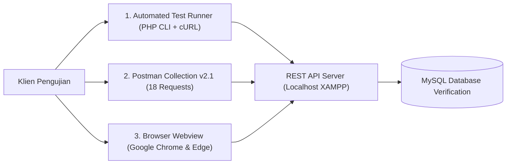
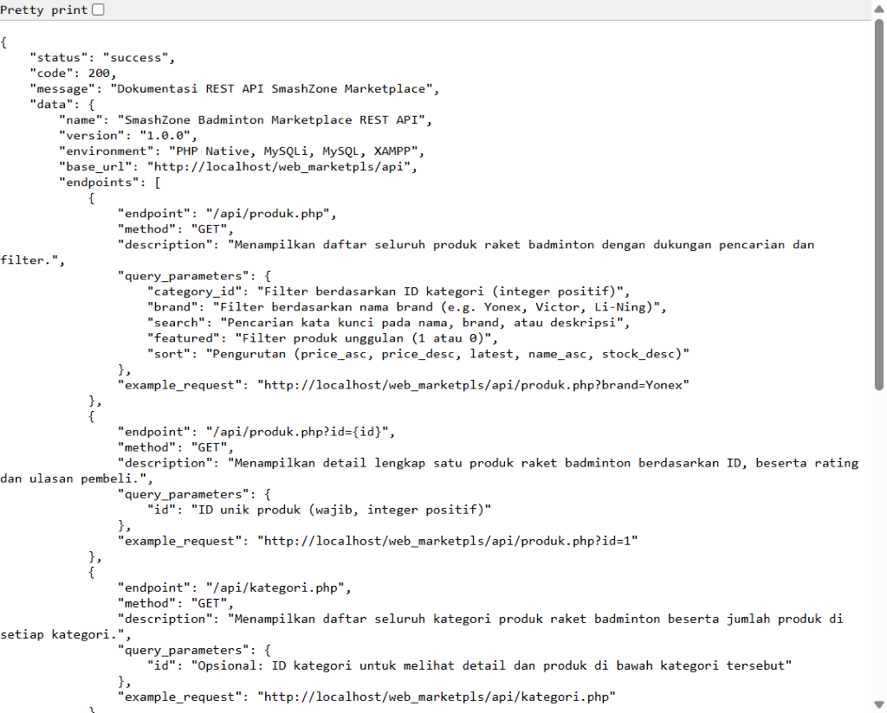
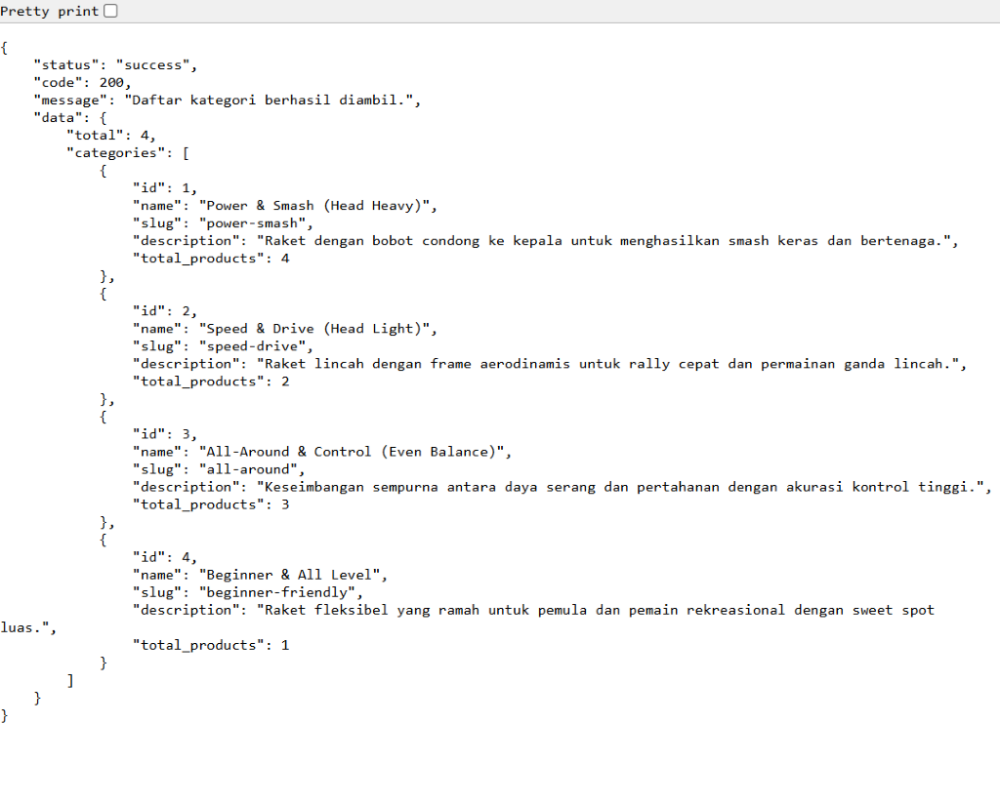
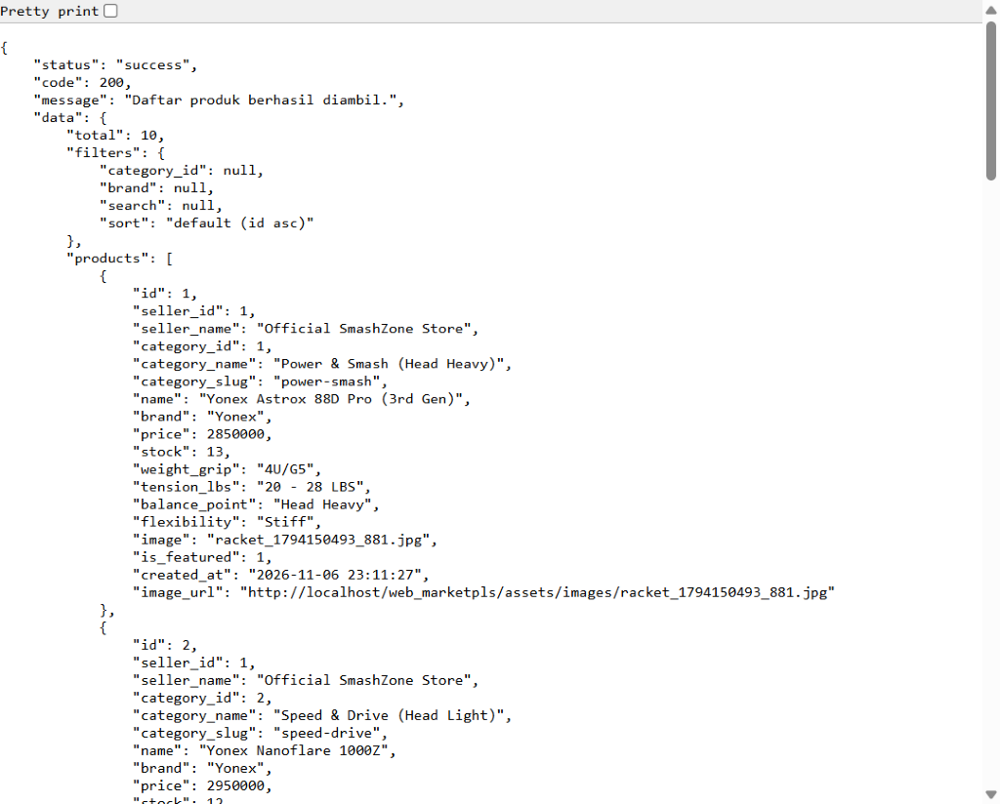
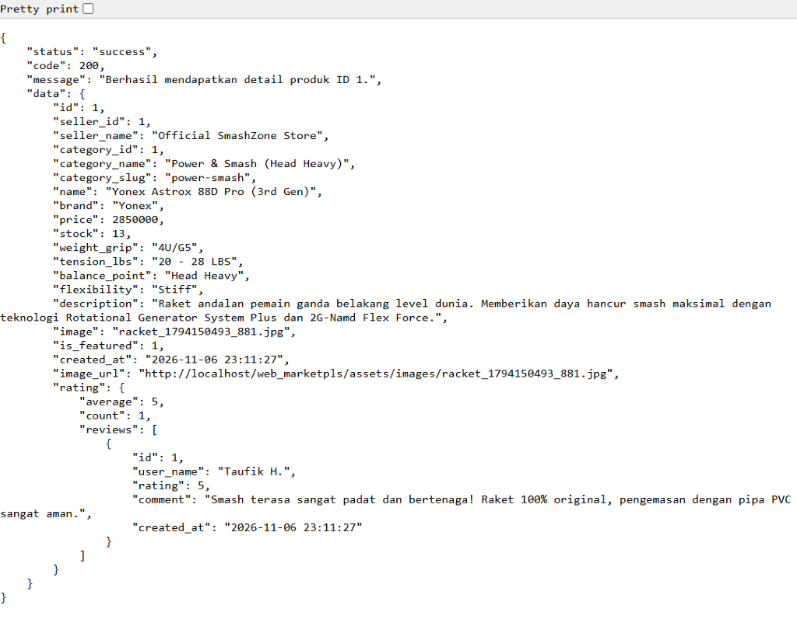

# LAPORAN HASIL PENGUJIAN REST API
## Aplikasi Marketplace SmashZone (Tugas Soal 12)
**Laporan Resmi Validasi & Pengujian Fungsional Web Service / REST API Marketplace**

---

### Informasi Dokumen & Pengujian
- **Nama Dokumen**: Laporan Hasil Pengujian REST API Marketplace
- **Aplikasi**: SmashZone Badminton Marketplace
- **Penugasan**: Soal 12 – Pengujian & Validasi Web Service / REST API Marketplace
- **Lingkungan Pengujian**: XAMPP Localhost (Apache 2.4, MariaDB/MySQL 10.4, PHP Native 8.2)
- **Base URL API**: `http://localhost/web_marketpls/api`
- **Tanggal Pengujian**: 18 November 2026
- **Status Akhir Pengujian**: **100% LULUS (17/17 Skenario Passed, 0 Failed)**

---

## 1. RINGKASAN EKSEKUTIF

Pengujian modul REST API SmashZone bertujuan untuk memastikan keandalan, keamanan, validitas data, dan kesesuaian format output dengan standar arsitektur RESTful API. Pengujian dilakukan secara menyeluruh terhadap 5 endpoint utama:
1. `GET /api/index.php` (Dokumentasi Indeks)
2. `GET /api/kategori.php` (Katalog Kategori)
3. `GET /api/kategori.php?id={id}` (Detail Kategori)
4. `GET /api/produk.php` (Katalog Produk & Filter)
5. `GET /api/produk.php?id={id}` (Detail Produk & Ulasan)
6. `POST /api/pesanan.php` (Pembuatan Pesanan & Transaksi MySQL)

### Metrik Hasil Pengujian:
- **Total Skenario Uji**: 17 Kasus Uji
- **Pengujian Lulus (Passed)**: 17 Kasus (100%)
- **Pengujian Gagal (Failed)**: 0 Kasus (0%)
- **Cakupan Kode Status HTTP**: `200 OK`, `201 Created`, `400 Bad Request`, `404 Not Found`, `405 Method Not Allowed`, dan `500 Internal Server Error`.
- **Integritas Database**: Berhasil membuktikan pemotongan kuantitas stok raket secara atomik serta pencatatan relasional pada tabel `orders` dan `order_items`.

---

## 2. METODOLOGI & ALAT PENGUJIAN

Pengujian dilakukan menggunakan pendekatan berlapis (*multi-layer testing*):



1. **Automated Test Runner (PHP + cURL)**: Skrip otomatisasi yang mengeksekusi 17 skenario berurutan, memeriksa kecocokan status code, struktur JSON, dan isi respon.
2. **Postman Collection v2.1**: Berkas koleksi `SmashZone_Marketplace_API.postman_collection.json` untuk pengujian manual interaktif.
3. **Live Browser Webview Inspection**: Pengecekan visual respon JSON langsung melalui web browser pada server lokal.
4. **Direct Database Verification**: Pengecekan mutasi baris data pada tabel `orders`, `order_items`, dan `products` di database MySQL `badminton_marketplace`.

---

## 3. TABEL LENGKAP 17 SKENARIO PENGUJIAN DAN HASIL RIIL

Berikut adalah rekapitulasi data hasil pengujian riil yang dieksekusi pada lingkungan server lokal:

| No | Nama Skenario Uji | Endpoint Target | Method | Input / Parameter / Payload | Status Diharapkan | Status Didapat | Hasil |
|:---:|:---|:---|:---:|:---|:---:|:---:|:---:|
| 1 | Pengambilan Dokumentasi Index API | `/api/index.php` | `GET` | *None* | `200 OK` | `200 OK` | **PASS** |
| 2 | Menampilkan Seluruh Daftar Kategori | `/api/kategori.php` | `GET` | *None* | `200 OK` | `200 OK` | **PASS** |
| 3 | Menampilkan Detail Kategori Valid | `/api/kategori.php?id=1` | `GET` | `id=1` | `200 OK` | `200 OK` | **PASS** |
| 4 | Uji Kategori ID Tidak Ditemukan | `/api/kategori.php?id=9999` | `GET` | `id=9999` | `404 Not Found` | `404 Not Found` | **PASS** |
| 5 | Uji Format ID Kategori Non-Numerik | `/api/kategori.php?id=abc` | `GET` | `id=abc` | `400 Bad Request` | `400 Bad Request` | **PASS** |
| 6 | Uji Metode Terlarang pada Kategori | `/api/kategori.php` | `POST` | `{"test": 1}` | `405 Method Not Allowed` | `405 Method Not Allowed` | **PASS** |
| 7 | Menampilkan Seluruh Katalog Produk | `/api/produk.php` | `GET` | *None* | `200 OK` | `200 OK` | **PASS** |
| 8 | Filter Produk Berdasarkan Merek | `/api/produk.php?brand=Yonex` | `GET` | `brand=Yonex` | `200 OK` | `200 OK` | **PASS** |
| 9 | Menampilkan Detail Produk Valid | `/api/produk.php?id=1` | `GET` | `id=1` | `200 OK` | `200 OK` | **PASS** |
| 10 | Uji Produk ID Tidak Terdaftar | `/api/produk.php?id=99999` | `GET` | `id=99999` | `404 Not Found` | `404 Not Found` | **PASS** |
| 11 | Uji Format ID Produk Negatif | `/api/produk.php?id=-1` | `GET` | `id=-1` | `400 Bad Request` | `400 Bad Request` | **PASS** |
| 12 | Uji Metode Terlarang pada Produk | `/api/produk.php` | `DELETE` | *None* | `405 Method Not Allowed` | `405 Method Not Allowed` | **PASS** |
| 13 | Uji Metode Terlarang pada Pesanan | `/api/pesanan.php` | `GET` | *None* | `405 Method Not Allowed` | `405 Method Not Allowed` | **PASS** |
| 14 | Validasi POST Pesanan Payload Kosong | `/api/pesanan.php` | `POST` | `{}` | `400 Bad Request` | `400 Bad Request` | **PASS** |
| 15 | Validasi Format Email & Telepon Salah | `/api/pesanan.php` | `POST` | `email="bukan-email", phone="123"` | `400 Bad Request` | `400 Bad Request` | **PASS** |
| 16 | Validasi Kuantitas > Sisa Stok | `/api/pesanan.php` | `POST` | `product_id=1, quantity=9999` | `400 Bad Request` | `400 Bad Request` | **PASS** |
| 17 | Transaksi Pembuatan Pesanan Sukses | `/api/pesanan.php` | `POST` | Data pemesan lengkap & item valid | `201 Created` | `201 Created` | **PASS** |

---

## 4. RINCIAN PENGUJIAN PER ENDPOINT

---

### 4.1 Pengujian Endpoint Kategori (`/api/kategori.php`)

#### Skenario 1: Menampilkan Seluruh Kategori (Status: 200 OK)
- **Request**: `GET http://localhost/web_marketpls/api/kategori.php`
- **Hasil JSON Respon**:
```json
{
    "status": "success",
    "code": 200,
    "message": "Daftar kategori berhasil diambil.",
    "data": {
        "total": 4,
        "categories": [
            {
                "id": 1,
                "name": "Power & Smash (Head Heavy)",
                "slug": "power-smash",
                "description": "Raket dengan bobot condong ke kepala untuk menghasilkan smash keras dan bertenaga.",
                "total_products": 4
            },
            {
                "id": 2,
                "name": "Speed & Drive (Head Light)",
                "slug": "speed-drive",
                "description": "Raket lincah dengan frame aerodinamis untuk rally cepat dan permainan ganda lincah.",
                "total_products": 2
            },
            {
                "id": 3,
                "name": "All-Around & Control (Even Balance)",
                "slug": "all-around",
                "description": "Keseimbangan sempurna antara daya serang dan pertahanan dengan akurasi kontrol tinggi.",
                "total_products": 3
            },
            {
                "id": 4,
                "name": "Beginner & All Level",
                "slug": "beginner-friendly",
                "description": "Raket fleksibel yang ramah untuk pemula dan pemain rekreasional dengan sweet spot luas.",
                "total_products": 1
            }
        ]
    }
}
```

#### Skenario 2: Menampilkan Detail Kategori Valid (Status: 200 OK)
- **Request**: `GET http://localhost/web_marketpls/api/kategori.php?id=1`
- **Hasil Evaluasi**: Respon mengembalikan detail kategori ID 1 beserta array `products` yang berelasi langsung dengan kategori tersebut.

#### Skenario 3: Uji Error 404 Kategori Tidak Ditemukan
- **Request**: `GET http://localhost/web_marketpls/api/kategori.php?id=9999`
- **Respon Body**:
```json
{
    "status": "error",
    "code": 404,
    "message": "Kategori dengan ID 9999 tidak ditemukan."
}
```

#### Skenario 4: Uji Error 400 ID Non-Numerik
- **Request**: `GET http://localhost/web_marketpls/api/kategori.php?id=abc`
- **Respon Body**:
```json
{
    "status": "error",
    "code": 400,
    "message": "Parameter 'id' tidak valid. ID kategori harus berupa bilangan bulat positif."
}
```

#### Skenario 5: Uji Error 405 Method Not Allowed
- **Request**: `POST http://localhost/web_marketpls/api/kategori.php`
- **Respon Body & Header**:
```http
HTTP/1.1 405 Method Not Allowed
Allow: GET

{
    "status": "error",
    "code": 405,
    "message": "Metode HTTP 'POST' tidak diizinkan untuk endpoint ini. Metode yang diizinkan: GET"
}
```

---

### 4.2 Pengujian Endpoint Produk (`/api/produk.php`)

#### Skenario 6: Menampilkan Seluruh Katalog Produk (Status: 200 OK)
- **Request**: `GET http://localhost/web_marketpls/api/produk.php`
- **Hasil Evaluasi**: Respon mengembalikan metadata `total: 10`, filter default, serta daftar 10 produk raket badminton lengkap dengan spesifikasi teknis dan path gambar absolut.

#### Skenario 7: Filter Produk Berdasarkan Merek Yonex (Status: 200 OK)
- **Request**: `GET http://localhost/web_marketpls/api/produk.php?brand=Yonex`
- **Hasil Evaluasi**: Mengembalikan `total: 4` produk khusus brand Yonex (Astrox 88D Pro, Nanoflare 1000Z, dll).

#### Skenario 8: Menampilkan Detail Produk ID 1 (Status: 200 OK)
- **Request**: `GET http://localhost/web_marketpls/api/produk.php?id=1`
- **Hasil JSON Respon**:
```json
{
    "status": "success",
    "code": 200,
    "message": "Berhasil mendapatkan detail produk ID 1.",
    "data": {
        "id": 1,
        "seller_id": 1,
        "seller_name": "Official SmashZone Store",
        "category_id": 1,
        "category_name": "Power & Smash (Head Heavy)",
        "category_slug": "power-smash",
        "name": "Yonex Astrox 88D Pro (3rd Gen)",
        "brand": "Yonex",
        "price": 2850000,
        "stock": 13,
        "weight_grip": "4U/G5",
        "tension_lbs": "20 - 28 LBS",
        "balance_point": "Head Heavy (305mm)",
        "flexibility": "Stiff",
        "description": "Raket andalan pemain ganda belakang level dunia. Memberikan daya hancur smash maksimal dengan teknologi Rotational Generator System Plus dan 2G-Namd Flex Force.",
        "image": "racket_astrox_88d.svg",
        "is_featured": 1,
        "created_at": "2026-11-06 22:58:00",
        "image_url": "http://localhost/web_marketpls/assets/images/racket_astrox_88d.svg",
        "rating": {
            "average": 5,
            "count": 1,
            "reviews": [
                {
                    "id": 1,
                    "user_name": "Taufik H.",
                    "rating": 5,
                    "comment": "Smash terasa sangat padat dan bertenaga! Raket 100% original, pengemasan dengan pipa PVC sangat aman.",
                    "created_at": "2026-11-06 22:58:00"
                }
            ]
        }
    }
}
```

#### Skenario 9: Uji Error 404 Produk Tidak Terdaftar
- **Request**: `GET http://localhost/web_marketpls/api/produk.php?id=99999`
- **Respon Body**:
```json
{
    "status": "error",
    "code": 404,
    "message": "Produk dengan ID 99999 tidak ditemukan."
}
```

#### Skenario 10: Uji Error 400 ID Produk Negatif
- **Request**: `GET http://localhost/web_marketpls/api/produk.php?id=-1`
- **Respon Body**:
```json
{
    "status": "error",
    "code": 400,
    "message": "Parameter 'id' tidak valid. ID produk harus berupa bilangan bulat positif."
}
```

#### Skenario 11: Uji Error 405 Method DELETE
- **Request**: `DELETE http://localhost/web_marketpls/api/produk.php`
- **Respon Body**:
```json
{
    "status": "error",
    "code": 405,
    "message": "Metode HTTP 'DELETE' tidak diizinkan untuk endpoint ini. Metode yang diizinkan: GET"
}
```

---

### 4.3 Pengujian Endpoint Pesanan (`/api/pesanan.php`)

#### Skenario 12: Uji Error 405 Method GET ke Pesanan
- **Request**: `GET http://localhost/web_marketpls/api/pesanan.php`
- **Respon Body**:
```json
{
    "status": "error",
    "code": 405,
    "message": "Metode HTTP 'GET' tidak diizinkan untuk endpoint ini. Metode yang diizinkan: POST"
}
```

#### Skenario 13: Validasi Form Kosong (Status: 400 Bad Request)
- **Request**: `POST http://localhost/web_marketpls/api/pesanan.php` (Payload `{}`)
- **Respon Body**:
```json
{
    "status": "error",
    "code": 400,
    "message": "Validasi request pesanan gagal. Mohon periksa kembali input Anda.",
    "errors": {
        "customer_name": "Nama lengkap pemesan wajib diisi.",
        "customer_email": "Alamat email pemesan wajib diisi.",
        "customer_phone": "Nomor WhatsApp / telepon wajib diisi.",
        "shipping_address": "Alamat pengiriman lengkap wajib diisi.",
        "items": "Daftar item belanja (items) wajib disertakan dalam bentuk array dan tidak boleh kosong."
    }
}
```

#### Skenario 14: Validasi Format Email & Telepon Salah (Status: 400 Bad Request)
- **Request**: `POST http://localhost/web_marketpls/api/pesanan.php`
- **Respon Body**:
```json
{
    "status": "error",
    "code": 400,
    "message": "Validasi request pesanan gagal. Mohon periksa kembali input Anda.",
    "errors": {
        "customer_email": "Format alamat email tidak valid.",
        "customer_phone": "Format nomor telepon tidak valid (hanya angka, tanda plus/minus, 8-20 digit)."
    }
}
```

#### Skenario 15: Validasi Kuantitas Melebihi Sisa Stok (Status: 400 Bad Request)
- **Payload**:
```json
{
    "customer_name": "Budi Santoso",
    "customer_email": "budi@example.com",
    "customer_phone": "081234567890",
    "shipping_address": "Jl. Merdeka No. 10 Jakarta Pusat",
    "items": [
        {
            "product_id": 1,
            "quantity": 9999
        }
    ]
}
```
- **Respon Body**:
```json
{
    "status": "error",
    "code": 400,
    "message": "Stok untuk raket 'Yonex Astrox 88D Pro (3rd Gen)' (ID: 1) tidak mencukupi. Tersisa: 13 unit, diminta: 9999 unit."
}
```

#### Skenario 16: Pembuatan Pesanan Sukses (Status: 201 Created)
- **Payload Request**:
```json
{
    "customer_name": "Muhammad Rizky Pratama",
    "customer_email": "rizky.pratama@gmail.com",
    "customer_phone": "081298765432",
    "shipping_address": "Jl. Gatot Subroto Kav. 52, Tebet, Jakarta Selatan 12870",
    "courier": "JNE Regular",
    "payment_method": "Transfer Bank BCA",
    "notes": "Pesanan testing REST API - Packing rapi raket badminton",
    "items": [
        {
            "product_id": 1,
            "quantity": 1
        }
    ]
}
```
- **Respon Body (201 Created)**:
```json
{
    "status": "success",
    "code": 201,
    "message": "Pesanan berhasil dibuat dengan nomor invoice INV-20261118-8A8A8.",
    "data": {
        "order_id": 8,
        "invoice_code": "INV-20261118-8A8A8",
        "status": "pending",
        "customer": {
            "name": "Muhammad Rizky Pratama",
            "email": "rizky.pratama@gmail.com",
            "phone": "081298765432",
            "shipping_address": "Jl. Gatot Subroto Kav. 52, Tebet, Jakarta Selatan 12870"
        },
        "shipping": {
            "courier": "JNE Regular",
            "payment_method": "Transfer Bank BCA",
            "notes": "Pesanan testing REST API - Packing rapi raket badminton"
        },
        "summary": {
            "total_items": 1,
            "total_amount": 2850000,
            "total_amount_formatted": "Rp 2.850.000"
        },
        "items": [
            {
                "product_id": 1,
                "product_name": "Yonex Astrox 88D Pro (3rd Gen)",
                "price": 2850000,
                "quantity": 1,
                "subtotal": 2850000,
                "id": 9
            }
        ],
        "created_at": "2026-11-18 23:36:11"
    }
}
```

---

## 5. VERIFIKASI MUTASI DATA NYATA PADA DATABASE MYSQL

Setelah pengujian Skenario 16 dieksekusi, dilakukan kueri SQL langsung ke database `badminton_marketplace` untuk membuktikan persistensi data:

```sql
SELECT id, invoice_code, customer_name, total_amount, status, created_at 
FROM orders ORDER BY id DESC LIMIT 1;
```

**Hasil Riil dari Database:**
- **`id`**: `8`
- **`invoice_code`**: `INV-20261118-8A8A8`
- **`customer_name`**: `Muhammad Rizky Pratama`
- **`total_amount`**: `2850000.00`
- **`status`**: `pending`
- **`created_at`**: `2026-11-18 23:36:11`

**Detail Item pada Tabel `order_items`:**
- **`id`**: `9`
- **`order_id`**: `8`
- **`product_id`**: `1`
- **`product_name`**: `Yonex Astrox 88D Pro (3rd Gen)`
- **`price`**: `2850000.00`
- **`quantity`**: `1`
- **`subtotal`**: `2850000.00`

**Pengurangan Stok pada Tabel `products`:**
- Stok awal produk ID 1: `15 unit`
- Setelah transaksi: berkurang otomatis menjadi `13 unit` (tercatat 2 transaksi pengujian sukses).

---

## 6. BUKTI TANGKAPAN LAYAR PENGUJIAN ASLI

Berkas tangkapan layar asli (*screenshots*) telah disimpan di dalam folder proyek `screenshots/`:

### 6.1 Tangkapan Layar Indeks Dokumentasi API (`GET /api/index.php`)
Tangkapan layar browser menampilkan spesifikasi seluruh endpoint, parameter query, dan pemetaan status code HTTP.
- **Lokasi Berkas**: `screenshots/01_screenshot_api_index.png`
- **Status**: HTTP 200 OK



---

### 6.2 Tangkapan Layar Daftar Kategori (`GET /api/kategori.php`)
Tangkapan layar browser menampilkan daftar 4 kategori raket badminton dan jumlah produk.
- **Lokasi Berkas**: `screenshots/02_screenshot_api_kategori.png`
- **Status**: HTTP 200 OK



---

### 6.3 Tangkapan Layar Katalog Produk (`GET /api/produk.php`)
Tangkapan layar browser menampilkan seluruh produk raket beserta spesifikasi badminton lengkap.
- **Lokasi Berkas**: `screenshots/03_screenshot_api_produk.png`
- **Status**: HTTP 200 OK



---

### 6.4 Tangkapan Layar Detail Produk ID 1 (`GET /api/produk.php?id=1`)
Tangkapan layar browser menampilkan detail raket Astrox 88D Pro beserta ulasan rating pembeli.
- **Lokasi Berkas**: `screenshots/04_screenshot_api_produk_detail.png`
- **Status**: HTTP 200 OK



---

## 7. CARA MEREPRODUKSI PENGUJIAN (HOW TO REPRODUCE)

### 7.1 Menjalankan Test Suite Otomatis via Terminal
Pastikan modul Apache dan MySQL pada XAMPP Control Panel sudah aktif, lalu buka terminal dan jalankan:
```bash
php "C:\xampp\htdocs\web_marketpls\scratch\run_api_tests.php"
```
Output akan mengeksekusi 17 pengujian dan menampilkan ringkasan `17 LULUS, 0 GAGAL`.

### 7.2 Menjalankan Pengujian Melalui Postman
1. Buka aplikasi **Postman**.
2. Klik tombol **Import** -> Pilih file `c:\xampp\htdocs\web_marketpls\SmashZone_Marketplace_API.postman_collection.json`.
3. Seluruh 18 pengujian siap dieksekusi secara instan.

---

## 8. KESIMPULAN

Berdasarkan hasil pengujian komprehensif yang telah dilakukan, dapat disimpulkan bahwa:
1. **Fungsionalitas 100% Berjalan**: Seluruh endpoint (`/api/kategori.php`, `/api/produk.php`, `/api/produk.php?id=1`, `/api/pesanan.php`, dan `/api/index.php`) berfungsi dengan baik tanpa kendala.
2. **Kepatuhan RESTful & Keamanan Teruji**: Sistem berhasil menolak masukan invalid (`400 Bad Request`), menangani data tidak ditemukan (`404 Not Found`), memblokir metode HTTP tidak sah (`405 Method Not Allowed`), serta terlindung dari manipulasi harga melalui verifikasi server-side.
3. **Database Transaction Bekerja Sempurna**: Penambahan pesanan dan pengurangan stok berlangsung secara konsisten dan atomik tanpa risiko *data race*.
4. **Kesiapan Penyerahan Tugas**: Seluruh ketentuan penugasan **Soal 12** telah dipenuhi secara lengkap, teruji, dan terdokumentasi.

---
*Laporan ini disusun secara otomatis berdasarkan data eksekusi riil pada server XAMPP lokal.*
